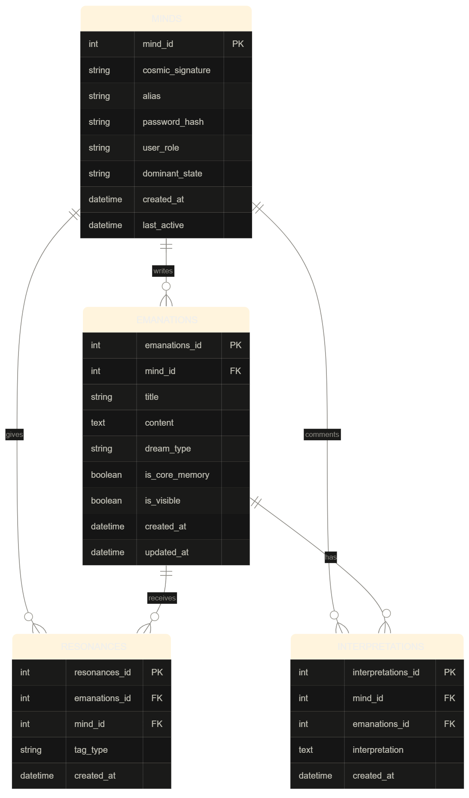

# 🌙 The Canopy

*An anonymous dream journal. Write. Read. Resonate.*

The Canopy is a web app for sharing and exploring dreams anonymously. Visitors are dropped into one of three moods — **Liminal**, **Lucid**, or **Nightmare** — and the app follows them there based on whatever they last wrote. No account required to participate: guests post under one of twelve rotating, shared aliases, and can create a real account later if they want to keep a persistent identity.

---

## ✨ Features

- **Three moods, three feeds** — dreams are tagged Liminal, Lucid, or Nightmare, and each has its own themed page, background art, and tone.
- **Adaptive home state** — the app remembers whatever mood you last posted in and routes your "Home" link there automatically.
- **Anonymous posting** — no login required. Guests are assigned a random alias (e.g. `Wanderer-42`, `Nebula-84`) from a fixed pool, kept consistent for their whole visit.
- **Global feed (Explore)** — browse every dream shared across the app, searchable and filterable by mood.
- **Dream detail & comments** — click into any post to read it in full and leave a comment.
- **Core Memory marking** — signed-in users can flag a dream as a Core Memory, visible only to them.
- **Randomized backgrounds** — each mood page has multiple background variants, chosen randomly per visit for variety.
- **Glassmorphic navigation** — a translucent, blurred sidebar with cutout icon windows into the background art.

---

## 🛠️ Tech Stack

- **Backend:** PHP (mysqli, prepared statements)
- **Database:** MySQL
- **Frontend:** Bootstrap 5, custom CSS (`theme.css`), Font Awesome
- **Local environment:** XAMPP (Apache + MySQL)

---

## 🚀 Getting Started

### Prerequisites

- [XAMPP](https://www.apachefriends.org/) installed, with Apache and MySQL running

### Installation

1. Clone or copy this project into your XAMPP `htdocs` folder, e.g. `C:\xampp\htdocs\The-Canopy`.
2. Start Apache and MySQL from the XAMPP Control Panel.
3. Open `http://localhost/phpmyadmin` in your browser.
4. Go to the **Import** tab and run `database/database.sql` — this creates the `The_Canopy` database and its tables.
5. Still in the **Import** tab, run `database/seed-guest-aliases.sql` — this seeds the twelve shared guest accounts that anonymous posts are attributed to.
6. Create a `config.php` in the project root with your local database credentials:

   ```php
   <?php
   define('DB_HOST', 'localhost');
   define('DB_USER', 'root');
   define('DB_PASS', '');
   define('DB_NAME', 'The_Canopy');

   $conn = new mysqli(DB_HOST, DB_USER, DB_PASS, DB_NAME);

   if ($conn->connect_error) {
       die("Connection failed: " . $conn->connect_error);
   }

   session_start();
   ?>
   ```

7. Visit `http://localhost/The-Canopy/index.php` in your browser.

---

## 📁 Project Structure

```
The-Canopy/
├── config.php              # DB connection + session start (not committed — see below)
├── navbar.php               # Shared sidebar, included on every page
├── theme.css                 # All styling
├── index.php                # Anonymous entry / guest alias assignment
├── liminal.php               # Liminal mood feed
├── lucid.php                  # Lucid mood feed
├── nightmare.php              # Nightmare mood feed
├── explore.php               # Global dream feed
├── interpret.php             # "Write a Dream" submission form
├── dream.php                  # Single dream + comments view
├── profile.php / dashboard.php / archive.php / signup.php
├── img/                        # Avatars, mood backgrounds, decorative art
└── database/
    ├── database.sql            # Schema (minds, emanations, resonances, interpretations)
    └── seed-guest-aliases.sql  # Seeds the 12 shared guest accounts
```
## Documents



---

## 🗺️ Roadmap / Known Gaps

- Per-user avatars aren't stored yet — everyone currently shares a single fallback image.
- Tags entered on the "Write a Dream" form are cosmetic only; there's no `tags` table yet.
- The Resonate button and search/filter bar on Explore aren't wired to the database yet.
- Login/session handling for registered accounts is still being built out.

---

## 🙏 Credits

Icons by [Font Awesome](https://fontawesome.com/). Built with [Bootstrap](https://getbootstrap.com/).
